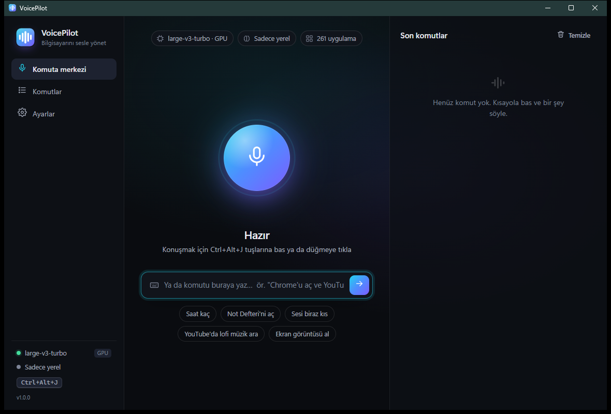

# VoicePilot

Control your Windows PC by voice, in Turkish or English. Press a shortcut (or say the wake word), say what you want, and VoicePilot does it: opens and closes apps, searches the web, types for you, controls volume and media, manages windows, sets reminders and more.



- **Speech recognition runs on your PC.** It uses Whisper `large-v3-turbo` through whisper.cpp, on the GPU via Vulkan. A 3-second command takes about 1 second to recognize on an RTX 2080 Super. Audio never leaves the machine.
- **Common commands are understood instantly and offline** by a built-in Turkish/English parser, which handles Turkish suffixes ("Chrome'u", "Spotify'ı", "Not Defteri'ni") and polite questions ("açar mısın").
- **Anything more complex goes to Claude.** It can use an Anthropic API key, or the Claude Code you already have installed with no key needed. Claude turns free-form requests into the same set of safe actions, for example "open Notepad and write a shopping list: milk, eggs, bread".

## Run

```
dist\VoicePilot.exe
```

On first launch it downloads the speech model (`ggml-large-v3-turbo-q5_0.bin`, 574 MB) from the official whisper.cpp repository on Hugging Face into `%LOCALAPPDATA%\VoicePilot\models`. It only does this once.

- **Talk:** press the shortcut, speak, and pause. It defaults to `Ctrl+Alt+Space`. If another app already uses that, VoicePilot picks the next free one: `Ctrl+Alt+J`, `Ctrl+Alt+K`, `Ctrl+Shift+F12` or `Pause`. The one in use is always shown in the sidebar, and you can change it in **Settings**.
- **Hands-free:** turn on the *wake word* in Settings, then start with "Pilot, …", e.g. "Pilot, Spotify'ı aç".
- **Type instead:** the box under the microphone runs the same commands.
- **Bind to a button:** `VoicePilot.exe --listen` starts listening in the running instance. You can map it to a mouse button, a Stream Deck key or a keyboard macro.
- Closing the window keeps it running in the tray, so the shortcut still works.
- Other flags: `--tray` starts hidden, and `--view settings|commands|home` opens a specific screen.

## Connecting Claude (for free-form requests)

The default mode is **Auto**, which uses the first of these that's available:

1. An Anthropic API key. Enter it in Settings; it's stored encrypted for your Windows account. VoicePilot also picks up `ANTHROPIC_API_KEY` from the environment. The default model is Claude Opus 5.5 at low effort; Sonnet 5.5 and Haiku 4.5 are selectable.
2. **Claude Code**: the `claude` CLI that's already installed. No key is needed, but the CLI must be signed in. Run `claude` once in a terminal and log in. VoicePilot detects whether it's signed in. **Test connection** in Settings checks it.

Without either, only the built-in commands work, and VoicePilot tells you when it didn't understand.

## What you can say

| | Türkçe | English |
|---|---|---|
| Apps | Chrome'u aç · Spotify'ı kapat · Not Defteri'ne geç · Discord'u zorla kapat | open Chrome · close Spotify · switch to Notepad · force close Discord |
| Web | YouTube'da lofi müzik ara · github.com'a git · YouTube'u aç ve kedi videoları ara | play lofi beats on YouTube · go to github.com · search for pizza on Google Maps |
| Volume & media | sesi kıs · sesi biraz aç · sesi yüzde 40 yap · sessize al · müziği durdur · sonraki şarkı | volume down · set volume to 40 · mute · pause the music · next song |
| Windows | pencereyi küçült / büyüt · masaüstünü göster · pencereyi sola yasla | minimize · maximize · show desktop · snap the window left |
| Keyboard | merhaba dünya diye yaz · kontrol c'ye bas · yeni sekme aç · aşağı kaydır · kaydet | type hello world · press alt f4 · new tab · scroll down · save |
| Folders | indirilenler klasörünü aç · D diskini aç | open downloads · open D drive |
| System | ekran görüntüsü al · bilgisayarı kilitle · uyku moduna al · bilgisayarı yeniden başlat | take a screenshot · lock the computer · restart the computer |
| Time | saat kaç · 10 dakika sonra çamaşırı hatırlat | what time is it · remind me in 10 minutes to check the oven |

You can chain commands with *ve / sonra / and / then*. **Custom commands** (in the Commands tab) map one phrase to several commands. For example, "çalışma modu" can run "open VS Code", "open Chrome" and "volume 30".

## Safety

- "Close X" quits the app completely. Apps that only hide to the tray (Discord, Steam, Spotify, WhatsApp…) are also ended in the background. Steam is shut down with `steam://exit`. If an app is still showing a window after being asked to close (usually "save changes?"), it is left open and you're told to check it. `vp procs <name>` shows which processes a close would end, without closing anything.
- Shutdown, restart, sign-out, force-closing apps and PowerShell commands ask for confirmation first. You answer with the buttons or by saying "evet"/"yes". Shutdown and restart also wait 15 s, so "kapatmayı iptal et" still works.
- If a step fails, the rest of the plan is skipped. Keystrokes are only sent after VoicePilot has confirmed the target window is actually in front, so they never land in the wrong app.
- If a browser window only matches by its title ("close YouTube"), VoicePilot closes that tab, not the whole window.
- Claude can only use the fixed action set (see `Brain.cs`). PowerShell commands can be turned off entirely in Settings.

## Project layout

```
src/VoicePilot.Core   engine: Audio (mic + VAD), SpeechToText (Whisper), LocalParser, Brain (Claude API / Claude Code),
                      Executor (Win32 actions), AppIndex (Start menu apps), Assistant (pipeline), Settings, History
src/VoicePilot.App    WPF + WebView2 desktop app: tray, global hotkey, on-screen overlay; UI in web/ (mock.js for browser preview)
src/VoicePilot.Cli    vp.exe: developer/diagnostic tool
```

Build with `pwsh -File publish.ps1`. The output goes to `dist\` and needs .NET 10 Desktop Runtime and WebView2. To regenerate the icon, run `pwsh -File src\VoicePilot.App\tools\make-icon.ps1`.

Handy `vp` commands, run from `dist\`:

```
vp selftest                         # 76 Turkish/English parser cases
vp parse "Chrome'u aç ve YouTube'a git"
vp plan "Not Defteri'ni aç ve bir alışveriş listesi yaz"   # shows Claude's plan without executing it
vp run "hesap makinesini aç"        # actually executes
vp listen                           # record one command from the mic and transcribe it
vp transcribe file.wav [auto|tr|en]
vp apps chrome | vp windows | vp devices | vp voices
```

## Data

- Settings and history: `%APPDATA%\VoicePilot`
- Models, app cache, log: `%LOCALAPPDATA%\VoicePilot`
- `VOICEPILOT_DEBUG=1` also logs ignored wake-word segments. It's off by default so that background talk isn't written to disk.
